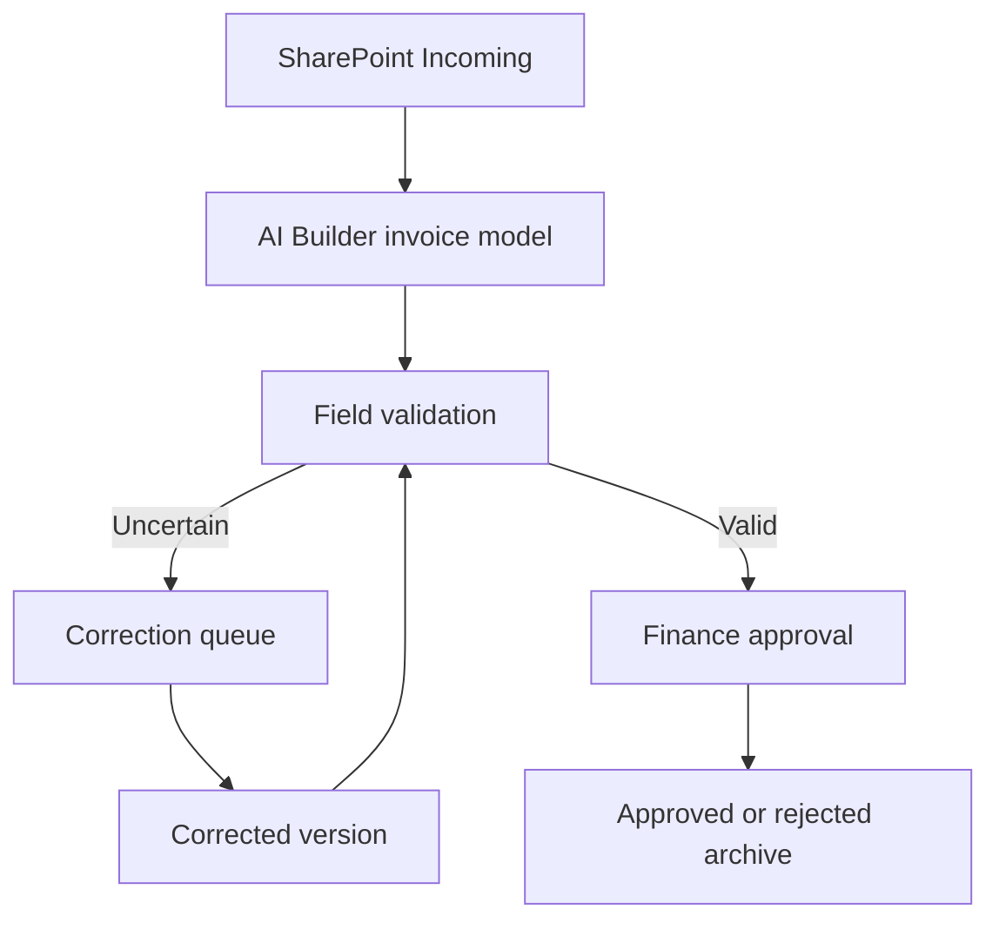

# Architecture

## Microsoft target

## Local implementation

Python CLI → validated synthetic inputs → domain logic → local SQLite state or HTML report. No Microsoft connector calls occur in the default walkthrough.

The cloud flow is an implementation plan. Local tests verify the reference logic; tenant identity, permission filtering, external delivery and connector failure semantics require separate integration tests.

## Trust boundaries

External content is untrusted. Identity and allowed recipients are resolved outside the model. The model cannot grant permissions, approve its own work or decide recipients. Source permissions must be enforced before retrieval; output validation alone cannot prevent leakage.
